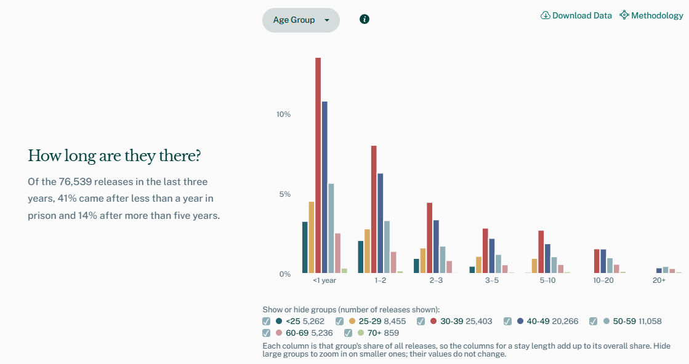
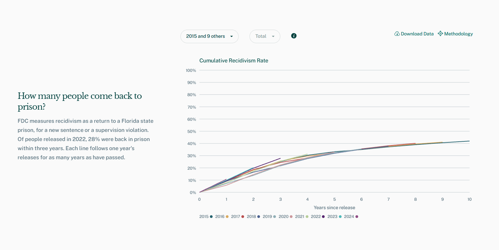
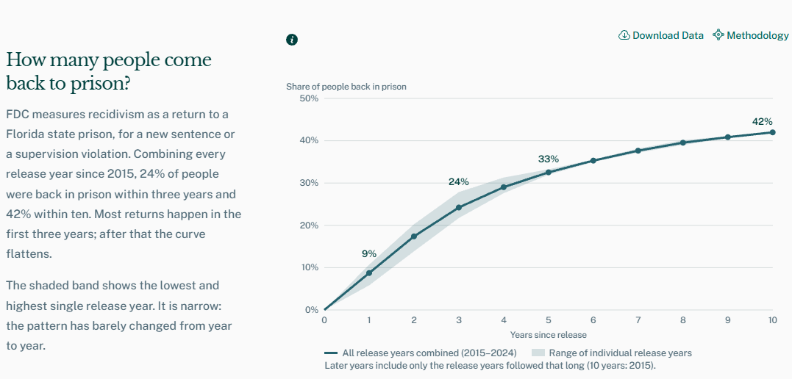
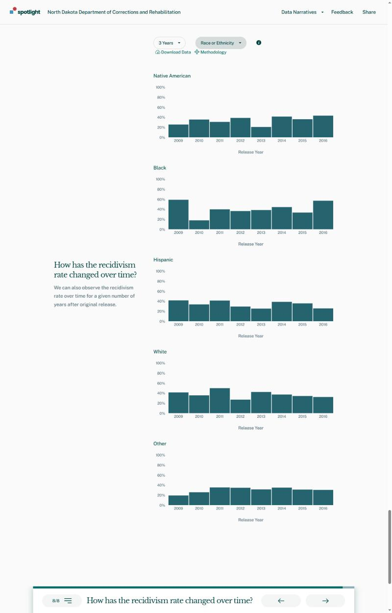
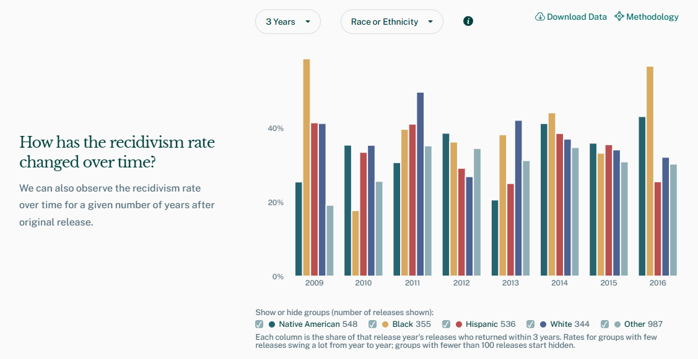
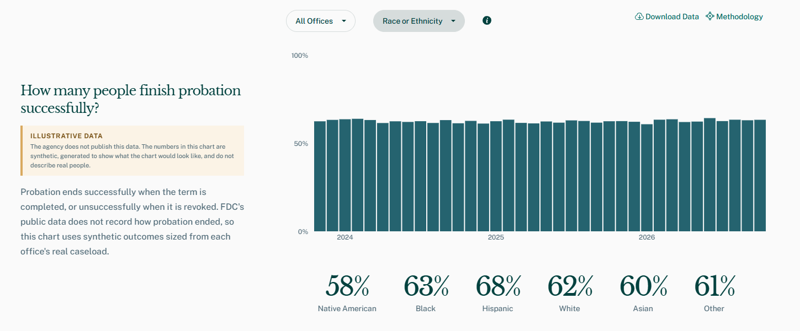
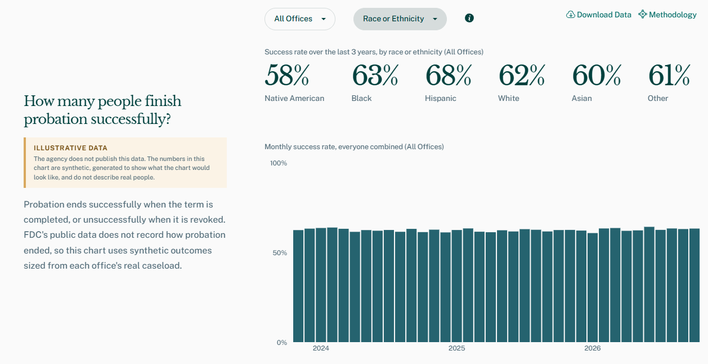

This repo is a fork done by Henry Deane that introduces Florida based data as well as chart decision changes for clarity and basic trouble shooting.

# Base level fixes
* Reworked drop down menu for facilities to seperate by category starting with prisons to make it easier to locate specific facilities.

* Resolved a load order bug that caused the "How has the prison population changed over time?" chart to load without margins, margins are now fixed for the chart in that location but still not visible on the landing page by design.

* ~~Added snapping to next and previous section similar to the functionality of already existing buttons~~ \
Tried it, didn't feel like it solved anything, removed it.

* Fixed an issue where selecting a category that had no data errored out the whole site until forced refresh, now empty categories are excluded from the drop down list and errors are resolved on one page.

* Added clarifying language under bar charts to communicate meaning of striped texture.

# Chart decisions

### How long are they there?
Before: Selecting from dropdown spawned seperate charts for each category.

Now: Using grouped columns keeps all the data on one chart, adding check boxes allows for fine tuning without requiring another drop down.

### How many people come back to prison?
Before: Lots of lines, all at the bottom half of the chart, crowding causes confusion and blocks the message.

Now: Single line shows throughput, shaded area shows variation, no unused upper white space. Unfortunately the main take away is the recidivism rate is pretty stable.

### How has the recidivism rate changed over time?
Before: Lots of white space, secondary drop down creates multiple charts.

Now: Grouped columns highlight breakout demographics and check boxes allow for finer control. Similar setup to *How long are they there*

### How many people finish probation successfully?
Before: Not a chart problem, an organizational problem, placing the percentages under the chart implies a stronger connection between the data and a lack of labels leaves the user to determine what that connection is.

Now: Definite seperation including labels to idenfity the percentage as an aggregate success rate and the bar chart as a monthly breakdown.

## That's all I've got 
I started to dive deeper into the Florida data and ran into the very reason for this organization, it's incredibly fractured. Better organized and accessible data could highlight which strategies are working, expose biases, and streamline the process of getting people out of the system when they deserve to be out.

# Spotlight

This repository contains npm packages related to our Spotlight data publishing product, as well as some shared configuration and tooling that involves multiple packages.

 

## Packages in this repository

More information about how to use each individual package can be found in their respective README files.

### [Spotlight API](spotlight-api/)

A thin Node/Express backend that serves data for the Spotlight website.

### [Spotlight Client](spotlight-client/)

A React application for the Spotlight website frontend.

## Development

### Getting set up

First, build the app locally.

1. Grab the source:

   `git clone git@github.com:Recidiviz/public-dashboard.git`

1. Install Yarn package manager:

   `brew install yarn`

   For alternative Yarn installation options, see [Yarn Installation](https://yarnpkg.com/en/docs/install).

1. Install dependencies:

   `yarn install`

That's it! We suggest installing a linting package for your preferred code editor that hooks into eslint. (Note that you may need to configure your linting plugin to use multiple package directories.)

Individual packages may require some additional configuration to work properly; refer to their respective README files for more information.

### Multi-package tools

There is a root `package.json` that defines some minimal repository-level dependencies. As a convenience, running `yarn install` in the root will trigger a post-install script that will install dependencies for all packages.

In addition, there are some Yarn scripts defined in the root package as a convenience for running packages in a coordinated fashion:

`yarn dev` — starts the development servers for the Spotlight API and the Spotlight Client in a single terminal window. Be sure you have configured each of those applications with the necessary environment variables, as described in their README files, or this will not work!

`yarn demo` — starts the development servers for the Spotlight API and the Spotlight client in "demo mode" by supplying the necessary environment variables in the command line. (This will run your local site off of fake data fixtures rather than live data from a calculation pipeline; see the [Spotlight API documentation](spotlight-api/#demo-mode) for more information.)

`yarn test` - runs the tests for all packages in a single command. (The output this produces is pretty messy at the moment but it can be useful for editor integration)

### Code editor integration

Your code editor may need some additional configuration to properly integrate with this monorepo setup. While not exhaustive, these are some tips we have found useful for ourselves:

#### Visual Studio Code

- install the [ESLint plugin](https://marketplace.visualstudio.com/items?itemName=dbaeumer.vscode-eslint), and in your Workspace settings, set the ESLint Working Directories to an array of all the package directories.
- install the [Jest plugin](https://marketplace.visualstudio.com/items?itemName=Orta.vscode-jest), and in your Workspace settings, set the "Jest command line" to `yarn test` (or one of the package-specific commands if you don't want to lint all packages; see `package.json` for details)

### Other tools

Style and formatting rules for this repository are defined with [ESLint](https://eslint.org/) and [Prettier](https://prettier.io/). Each package maintains its own configuration, and there is no central one, and thus no single command that will lint the entire repository.

Linting rules (including auto-fixing) are applied to changed files in a pre-commit hook using [Husky](https://github.com/typicode/husky) and [lint-staged](https://github.com/okonet/lint-staged). These are configured in the root `package.json`.

We use [Github Actions](https://docs.github.com/en/free-pro-team@latest/actions) for continuous integration tasks, which include lint checks as well as automated JavaScript tests where applicable.

## Adding new packages

Packages in this repository are independent of each other; just create a new directory, and then run `yarn init` in your package directory as you normally would. (The entire repo is covered by a GPL V3 license, so make sure your package's `license` field conforms to that.)

There are some conventions you should follow when setting up your new package, unless you have a compelling and well-documented reason not to:

- The package name should be the same as the directory name
- `yarn dev` should execute the main entry point for development (e.g., starting a development server)
- `yarn lint` should run your static checks (linting, type-checking)
- `yarn test` should run your JS tests, if you have any (which you should!)
